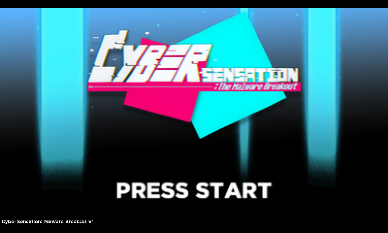
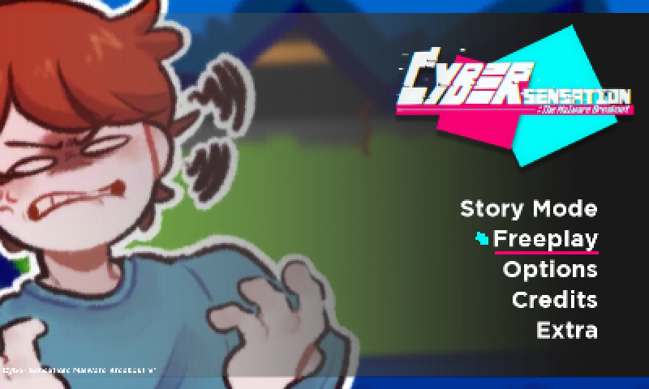
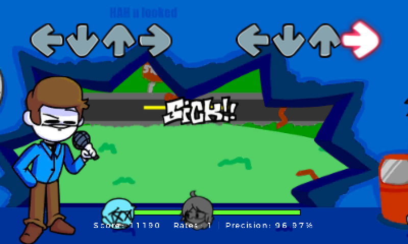

# Cyber Sensation 3DS

**Cyber Sensation: Malware Breakout**, the Friday Night Funkin' mod, running natively on the **Nintendo 3DS**, including the Old 3DS.

This is not an emulator or a port of the PC executable. It is a small FNF engine written in C (citro2d/citro3d), plus a
PC converter that reads the mod's **Codename Engine** files (charts, characters, stages, menus, music) and turns them into
3DS-friendly data.

> **Download:** the [Releases page](https://github.com/underplayer100/CyberSensation-3DS/releases/latest) has a ready-to-play
> `.cia` with the whole game inside. You do not need the PC game.

## Game files and permission
- The **source code** in this repository (engine and converter) contains no game or mod assets.
- The **release packs** (`CyberSensation-3DS-full.cia`, `CyberSensation-3DS-SD.zip`) contain the art, music and charts of
  *Cyber Sensation: Malware Breakout*, converted for the 3DS. They belong to the mod team and are shared with credit
  (see Credits). Friday Night Funkin' assets are used under its own "do whatever you want" permission.
- If you are part of the mod team and want the packs removed, open an issue and they will be taken down.

## Screenshots
| Title screen | Main menu |
|---|---|
|  |  |
| **Story Mode** | **Freeplay** |
|  |  |
| **Gameplay** | **Gameplay** |
|  |  |

*Top screen of the 3DS (400x240), shown at 2x.*

## Features
- **Gameplay**:
  - real charts (Codename Engine and legacy FNF formats), holds, BPM changes, camera events, zoom on beats
  - ratings (sick/good/bad/shit), combo, score, accuracy, health bar with icons, game over, pause menu
- **Characters and stages** from the mod:
  - Sparrow atlases with animation offsets, scaled around the sprite centre like Flixel, parallax scroll
  - Adobe Animate texture atlases (girlfriend, nondead) flattened to frames by the converter
  - simple stage and song scripts read by the converter: character positions, flips, camera offsets, fixed cameras,
    zoom, sprites created in `create()`/`postCreate()`, conditions on the song name
  - sprites, solid colour boxes (`makeGraphic`), scrolling tiled backgrounds (`FlxBackdrop`) and extra characters
    (`new Character`) created by stage and song scripts
  - script timelines (`stepHit`/`beatHit`): fades, flashes, character tints and white silhouettes, characters that
    move, flip, appear or disappear, and opponent swaps (`dad = shadum`, as in *Cyber Trouble*)
  - some GLSL shaders are pre-rendered by the converter and played back as an animation (*Yawarakai*'s spinning rings)
  - alternate sing animations, "No Animation" and "GF Sing" notes
- **Audio**:
  - music and voices streamed from the SD card as DSP ADPCM, decoded by the 3DS sound chip, so it uses almost no CPU
  - voices muted on a miss
- **Menus recreated from the mod's scripts**:
  - title screen (beat-synced lasers)
  - main menu (random art, animated bar and spinning square)
  - Story Mode (5 chapters, main and side stories)
  - Freeplay (song carousel, covers, difficulties, music preview, personal best, animated wave background)
  - Options (downscroll, ghost tapping, button mapping for each arrow)
- Faithful to Codename Engine: character placement and camera, health bar and bouncing icons, Score/Misses/Accuracy with rank, rating popups and combo numbers, note splashes, per-character note skins, countdown and miss sounds, strum intro
- Runs at **60 fps** on an Old 3DS. Installable as `.cia` (HOME menu icon and banner with sound) or `.3dsx`.

## Install (release)
Pick **one** of these:

- **Easiest:** download `CyberSensation-3DS-full.cia` and install it with FBI. The whole game is inside, nothing else to copy.
- **SD card version:** download `CyberSensation-3DS-SD.zip` and unzip it at the root of your SD card
  (it creates `3ds/fnf3ds/cyber/`). Then install `CyberSensation-3DS.cia` with FBI, or put `CyberSensation-3DS.3dsx`
  in `/3ds/` and start it from the Homebrew Launcher.

Your console needs `sdmc:/3ds/dspfirm.cdc` for sound (dump it with DSP1).
If both exist, the SD card data is used before the data inside the full `.cia`.
Updating with the SD card version: unzip the new `CyberSensation-3DS-SD.zip` over the old files (replace them).
Switching to the full `.cia`: delete `sdmc:/3ds/fnf3ds/cyber/` first.

## Converting the mod
Only needed to make the game files yourself (for example after a mod update). Players can use the release packs.

Requirements: Python 3 with `pillow` and `numpy`, `ffmpeg` in PATH, devkitPro (`tex3ds`, `mkbcfnt`).

```
gcc -O2 -o tools/adpcm_enc.exe tools/adpcm_enc.c
py -3 tools/convert.py "<path to the game>/bin" sd/3ds/fnf3ds/cyber
```
The `--vite` flag skips characters and stages that are already converted.
`tools/envoi.py` can send everything to a 3DS running ftpd (`set FNF3DS_HOST=<3DS IP>`).

## Building
devkitPro with devkitARM, libctru, citro2d and citro3d:
```
make
py -3 tools/make_meta.py "<path to the game>/bin"            # icon + banner, needs bannertool
powershell -File tools/build_cia.ps1                        # needs makerom
powershell -File tools/build_cia.ps1 -Full                  # .cia with the converted mod inside
powershell -File tools/package_release.ps1                  # all release files in release/
```
`tools/test_all.ps1` plays every song in the Azahar emulator and keeps a screenshot of each one in `test_all/`.
`tools/audit.py` lists, song by song, every script instruction of the mod that the converter applies or ignores
(report in `docs/audit.md`).
`tools/pc_ref.py` takes reference screenshots in the PC game at the same song positions as the 3DS autotest
(5, 15, 30, 45 s...): `install`, `run` (the game plays off screen in botplay), `compare` (side-by-side PC | 3DS sheets),
then `remove` to restore the mod's `global.hx`.

## Controls
| | |
|---|---|
| D-Pad / ABXY / Circle Pad | arrows (left, down, up, right), by default |
| Options > Touches | choose the buttons of each arrow (A, B, X, Y, L, R, ZL, ZR, D-Pad, Circle Pad, C-Stick, SELECT) |
| START | pause |
| L / R | jump 5 songs in Freeplay |

## Not supported yet
Most GLSL shaders (glitch, colour grading, bloom, rays), video cutscenes, song mechanics, `update()` code and
`HScript Call` events.

## Known issues / to fix
Found by playing every song in the Azahar emulator (`tools/test_all.ps1`) and comparing with the mod's scripts.
*Data Diva*, *That's Me* and *Cyber Trouble* have been checked side by side with the PC game (`tools/pc_ref.py`).

**Character placement**
- *Sweet Love*, *Glitcher*, *Context EX*, *Highlights EX*, *Errorians*: the player is partly off screen on the right.
- *Bobalolazing* (minecraft): Taeyai is huge in the middle and Bob is tiny in the corner. The chart's gf (`none`) does not exist.
- *New Hope*, *Hoax* (dust), *Underground*, *Karma* (tans): the characters look small at the bottom
  of the screen. Their camera offsets come from scripts (`cameraOffset.y -= 700`) and may need checking.
- *No More Sense (I'm Dead)*: nondead is drawn near the top of the screen.
- Reflections (`redad`, `rebf`, `regf` in garage, tans, dust, shadow) are loaded but drawn upright: flipY and skew
  are not supported yet.
- Songs with more than 3 strumlines (*Cyberfunk Attack*, *Errorians*, *Our Hope*, *Fun Gang*, *Me*, *No More Sense*):
  only the first three characters are shown. The others' notes are played, but nobody sings them.
- Tweens are linear (FlxEase curves are not reproduced); floating characters moved in `update()` stay still.

**Stages and backgrounds**
- *Liquated*: the `camellia` stage does not exist in the mod files, so the background is black.
- *No More Sense (I'm Dead)*: the `none` stage has no XML, so the background is black.
- *Me*: a big black rectangle covers part of the background. The extra characters (Minus, Shadow) are not shown.
- *Soft Machine*, *New Day*, *Yawarakai*: a black strip shows on the left side of the background.
- *Open System* (room): the animated hologram panels are missing (they use a shader).
- Not supported: most GLSL shaders (colour grading, glitch, bloom, rays), video cutscenes, sprites that scripts
  load or swap during the song.
- *Cyber Trouble*: the full-screen glitch (`glitchscreen` shader) is missing.

**Story mode**
- Cutscenes are MP4 videos in the mod (`videos/CH1/...` with voice and subtitles): not played yet.
- Chapter 1 ends on *Last Hope* through a fake crash on PC (the game closes after *Wear a Mask*, then starts on
  *Last Hope* at the next launch). Not reproduced yet: play *Last Hope* from Freeplay.

**Health bar icons**
- These icons do not exist in the mod, so the default `face` icon is shown, like on PC: `bfex`, `cj`, `ruby`,
  `perseverance-sans`, `shini`, `sticky`, `taeyaiminus`.

**Notes and gameplay**
- *Liquated*: the opponent's arrows use a white note skin. Check whether this matches the PC version.
- Special notes (hurt, bullet, and so on) are played as normal notes.
- The ~2000 `HScript Call` chart events (lyrics, flashes, camera tricks) are ignored.

## Credits
- **Friday Night Funkin'** by ninjamuffin99, PhantomArcade, evilsk8r and Kawai Sprite
- **Codename Engine** by the Codename Crew
- **Cyber Sensation: Malware Breakout** by its mod team; all of the mod's characters, art and music belong to them.
  Play the original on PC and support its creators.
- 3DS engine and converter: this repository
